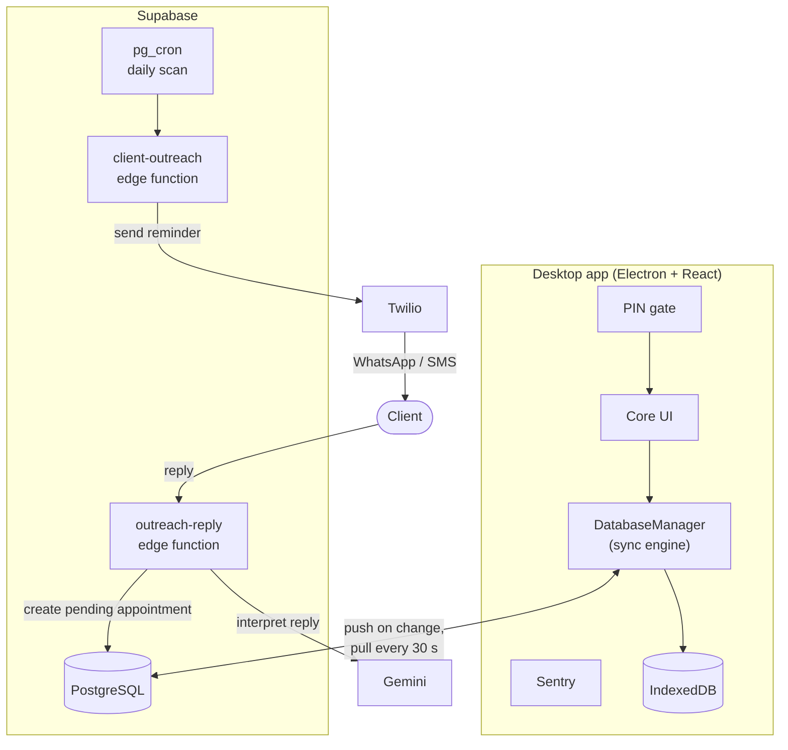

# AutoShift

Offline first showroom management for Windows, with AI-assisted service reminders over WhatsApp and SMS.


AutoShift is an Electron desktop app for running an automobile showroom. It keeps clients, vehicles, service jobs and appointments in a local IndexedDB store, syncs them to Supabase when a connection is available, and uses Twilio and Google Gemini to remind customers about service dates and book their replies as appointments.

It ships as a Windows `.exe`.


## Contents

- [Why it exists](#why-it-exists)
- [Features](#features)
- [Tech stack](#tech-stack)
- [Architecture](#architecture)
- [Outreach flow](#outreach-flow)
- [How sync works](#how-sync-works)
- [Getting started](#getting-started)
- [Permissions](#permissions)
- [Security notes](#security-notes)
- [Troubleshooting](#troubleshooting)
- [Project structure](#project-structure)
- [License](#license)

## Why it exists

Showroom software that depends on a live connection stalls when the network drops, and most of it leaves follow-up calls to staff. AutoShift is built around two changes to that:

- Every read and write goes to IndexedDB first, so the UI responds the same online or offline. Queued changes upload when the connection returns.
- Customers get service reminders on WhatsApp or SMS, and their replies are read by Gemini and turned into pending appointments without anyone at the desk touching them.

## Features

### Client outreach

A `pg_cron` job scans upcoming vehicle service dates once a day. For each match, a Supabase edge function asks Twilio to send the client a WhatsApp or SMS reminder. When the client replies, a second edge function passes the text to Gemini, which works out what the client wants and creates a `pending` appointment using the vehicle's history. The desktop app picks it up on its next sync.

### Offline-first sync

- Reads and writes hit IndexedDB first.
- Changes go into a local queue and are pushed to Supabase (PostgreSQL) as soon as the connection allows.
- Every 30 seconds the app pulls changes made on other devices.
- Failed uploads are retried up to 3 times with exponential backoff.
- Concurrent edits are merged per field using last-write-wins timestamps, so two people editing different fields of one record don't overwrite each other.
- Large datasets are fetched in chunks to keep memory use down.

### PIN login

The login screen is a touch numpad, meant for shared terminals on the showroom floor. A staff PIN covers everyday work: registering vehicles, logging services, viewing appointments. An admin PIN is needed to edit or delete records, force a resync, or clear the local cache.

### Management modules

- Client registry, with full profiles and service history
- Vehicle lookup, linking each car to its owner and maintenance log
- Service tracking for repair and maintenance jobs
- Appointment scheduling, either booked by hand or created automatically from client replies

### Monitoring

Sentry (`@sentry/react` v10) captures React errors, sync exceptions and crashes. The UI shows online/offline status, and sync activity is logged on screen.

## Tech stack

| Layer | Technology | Used for |
|---|---|---|
| Desktop shell | Electron 41.5.0 | Packaging the `.exe` |
| Frontend | React 18 (CommonJS) | UI and state |
| Local storage | IndexedDB (native API) | Offline data |
| Cloud database | Supabase (PostgreSQL) | Remote sync, edge functions |
| AI | Google Gemini | Reading client replies |
| Messaging | Twilio | WhatsApp and SMS |
| Monitoring | Sentry | Errors and sync failures |
| Icons | Lucide React | UI icons |
| Styling | Vanilla CSS-in-JS | Component styles |

## Architecture



## Outreach flow

1. `pg_cron` runs daily and finds vehicles whose `next_due` service date is coming up.
2. The `client-outreach` edge function fires.
3. Twilio sends the client a message along the lines of: "Your [Car Model] is due for service on [Date]. Reply YES to book an appointment."
4. The client replies on WhatsApp or SMS.
5. The `outreach-reply` edge function receives the reply and sends it to Gemini to interpret.
6. A `pending` appointment is created in Supabase.
7. It reaches the desktop app on the next 30-second sync.

After the initial setup, no staff action is needed for any of this.

## How sync works

`DatabaseManager` handles every user action the same way:

1. The user does something, such as booking an appointment, adding a service or registering a car.
2. The change is saved to IndexedDB and the UI updates at once.
3. The change is added to the local `operation_queue`.
4. The app tries to push it to Supabase right away. On success the item leaves the queue. On failure it is retried with exponential backoff, up to 3 attempts.
5. Every 30 seconds a background pull fetches remote rows where `created_at > last_sync`.
6. Conflicts are resolved with last-write-wins at the field level.

## Getting started

### Prerequisites

- Node.js 18 or later
- Windows (needed to package the `.exe`)
- A Supabase account
- A Twilio account with WhatsApp or SMS enabled
- A Google Gemini API key

### 1. Install dependencies

```bash
npm install
```

### 2. Configure the environment

Run the Windows setup script:

```bash
configure_showroom.bat
```

Or create a `.env` file in the project root by hand:

```env
# Supabase
REACT_APP_SUPABASE_URL=your_supabase_url
REACT_APP_SUPABASE_PUBLISHABLE_KEY=your_public_anon_key

# Twilio
TWILIO_ACCOUNT_SID=your_twilio_sid
TWILIO_AUTH_TOKEN=your_twilio_token
TWILIO_FROM_NUMBER=your_twilio_number

# Gemini
GEMINI_API_KEY=your_gemini_api_key

# Sentry
REACT_APP_SENTRY_DSN=your_sentry_dsn

# Showroom
REACT_APP_SHOWROOM_NAME=Your Showroom Name
REACT_APP_SHOWROOM_PIN=staff_pin_here
REACT_APP_ADMIN_PIN=admin_pin_here
```

Make sure `.env` is listed in `.gitignore` before your first commit. It holds your Twilio token and Gemini key.

### 3. Set up the Supabase schema

Create four tables, `clients`, `cars`, `services` and `appointments`, each with a UUID primary key.

Turn on Row Level Security and add a policy for the `anon` role on each table. For `clients`:

```sql
CREATE POLICY "Enable all for anon" ON public.clients
FOR ALL TO anon USING (true) WITH CHECK (true);
```

Repeat for `cars`, `services` and `appointments`. See [Security notes](#security-notes) before using this policy with real data.

### 4. Deploy the edge functions

```bash
supabase functions deploy client-outreach
supabase functions deploy outreach-reply
```

Set `TWILIO_ACCOUNT_SID`, `TWILIO_AUTH_TOKEN`, `TWILIO_FROM_NUMBER` and `GEMINI_API_KEY` as secrets on your Supabase project so the functions can read them.

### 5. Run in development

```bash
npm start
```

### 6. Build the desktop app

Run this as a Windows administrator, or with Developer Mode turned on:

```bash
npm run electron-pack
```

## Permissions

| Action | Staff PIN | Admin PIN |
|---|---|---|
| Register a vehicle | Yes | Yes |
| Add a service record | Yes | Yes |
| View appointments | Yes | Yes |
| Edit existing records | No | Yes |
| Delete records | No | Yes |
| Force resync | No | Yes |
| Clear local cache | No | Yes |

## Security notes

- The policy in step 3 lets anyone holding the public anon key read and write every row in those tables. That is fine for development. Before real customer data goes in, replace it with narrower policies.
- The PINs are read from `.env` at build time, so they end up inside the packaged app. They keep casual users out of admin actions on a shared terminal, but they are not a substitute for server-side access control.
- Never commit `.env`, and rotate the Twilio token and Gemini key if either is ever pushed to a public repository.

## Troubleshooting

**The `.exe` build fails on Windows.** Re-run `npm run electron-pack` from a terminal opened as administrator, or turn on Developer Mode in Windows settings.

**Changes made on another device don't show up.** Check the sync log in the UI first. If it reports repeated upload failures, confirm that `REACT_APP_SUPABASE_URL` and `REACT_APP_SUPABASE_PUBLISHABLE_KEY` are correct and that the RLS policies exist on all four tables. An admin can force a resync or clear the local cache from the app.

**Clients aren't receiving messages.** Check that the edge function secrets are set and that `client-outreach` is deployed. If you're using the Twilio WhatsApp sandbox, each recipient has to opt in to it first.

**Replies don't become appointments.** Confirm that Twilio's incoming-message webhook points at your deployed `outreach-reply` function, and that `GEMINI_API_KEY` is set as a secret.

## Project structure

```
autoshift/
├── src/
│   ├── AutoShowroom.jsx          # App shell, state, UI logic
│   ├── database/
│   │   ├── DatabaseManager.js    # Sync engine and data API
│   │   └── LocalDatabase.js      # IndexedDB schema and operations
│   └── supabaseClient.js         # Supabase connection
├── supabase/
│   └── functions/
│       ├── client-outreach/      # Twilio sender
│       └── outreach-reply/       # Gemini reply parser
├── configure_showroom.bat        # Windows setup script
├── .env                          # Local environment variables
└── package.json
```

## License

Released under the [MIT License](LICENSE).
